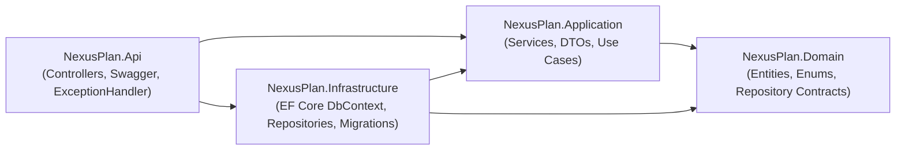
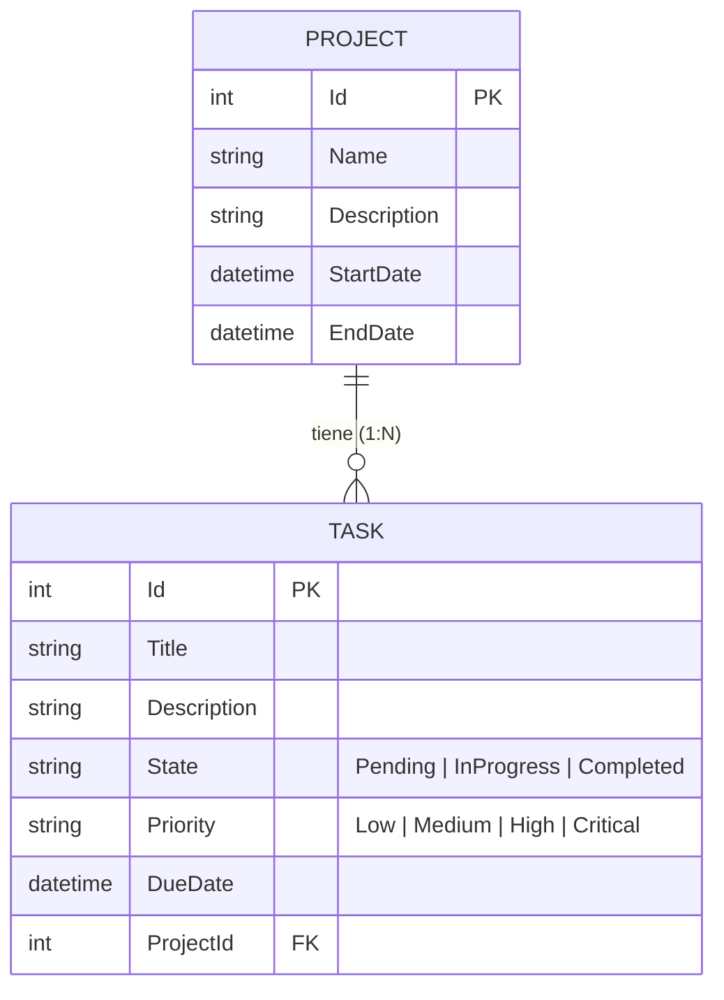
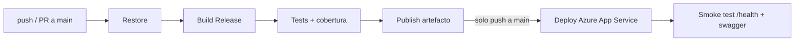

# 🚀 NexusPlan API — Clean Architecture (.NET 10)

API REST para la gestión de **proyectos** y sus **tareas**, construida con **Clean Architecture** en **ASP.NET Core 10**, **Entity Framework Core 10** y **SQL Server / Azure SQL**, documentada con **Swagger** y desplegada en **Azure App Service** mediante **GitHub Actions**.

[](https://github.com/Phoenixx99JD/NexusPlan/actions/workflows/ci-cd.yml)

| Entregable | Enlace |
|---|---|
| Repositorio | https://github.com/Phoenixx99JD/NexusPlan |
| API desplegada (Swagger) | `https://<AZURE_WEBAPP_NAME>.azurewebsites.net/swagger` |
| Pipeline CI/CD | https://github.com/Phoenixx99JD/NexusPlan/actions |

---

## 🧱 Clean Architecture

La solución está dividida en **4 capas de código fuente** y **1 proyecto de pruebas**, respetando la regla de dependencia hacia adentro (`Api -> Infrastructure / Application -> Domain`):

```
NexusPlan.sln
├── src/
│   ├── NexusPlan.Domain          → Capa de Dominio (sin dependencias externas)
│   │   ├── Entities/             → Project, TaskItem
│   │   ├── Enums/                → TaskState, TaskPriority
│   │   ├── Exceptions/           → NotFoundException, BusinessRuleException, ValidationException
│   │   └── Repositories/         → Contratos IProjectRepository, ITaskRepository
│   │
│   ├── NexusPlan.Application     → Capa de Aplicación / Casos de Uso (solo depende de Domain)
│   │   ├── Dtos/                 → Contratos de entrada/salida y validaciones
│   │   ├── Interfaces/           → IProjectService, ITaskService
│   │   ├── Services/             → ProjectService, TaskService, ProgressCalculator
│   │   └── DependencyInjection.cs
│   │
│   ├── NexusPlan.Infrastructure  → Capa de Infraestructura / Persistencia (EF Core 10)
│   │   ├── Data/                 → NexusPlanDbContext + Configurations (Fluent API)
│   │   ├── Migrations/           → Migraciones de base de datos relacional
│   │   ├── Repositories/         → ProjectRepository, TaskRepository
│   │   └── DependencyInjection.cs
│   │
│   └── NexusPlan.Api             → Capa de Presentación / API REST
│       ├── Controllers/          → ProjectsController, TasksController
│       ├── Exceptions/           → GlobalExceptionHandler (ProblemDetails RFC 7807)
│       └── Program.cs            → Swagger, HealthChecks y pipeline HTTP
│
├── tests/NexusPlan.Tests
│   ├── Unit/                     → Pruebas unitarias de casos de uso
│   └── Integration/              → Pruebas end-to-end HTTP con WebApplicationFactory
├── infra/main.bicep              → Infraestructura como código (App Service + Azure SQL)
├── scripts/                      → Script de aprovisionamiento en Azure
└── .github/workflows/            → Pipeline CI/CD
```





## 📚 Endpoints

### Proyectos — `/api/projects`
| Método | Ruta | Descripción |
|---|---|---|
| GET | `/api/projects` | Lista proyectos (incluye % de avance) |
| GET | `/api/projects/{id}` | Obtiene un proyecto |
| POST | `/api/projects` | Crea un proyecto |
| PUT | `/api/projects/{id}` | Actualiza un proyecto |
| DELETE | `/api/projects/{id}` | Elimina un proyecto (**409** si tiene tareas pendientes / en progreso) |
| GET | `/api/projects/{id}/tasks?state=&priority=` | Tareas del proyecto, con filtros |
| GET | `/api/projects/{id}/progress` | Porcentaje de avance según tareas completadas |

### Tareas — `/api/tasks`
| Método | Ruta | Descripción |
|---|---|---|
| GET | `/api/tasks?state=&priority=&projectId=` | Lista / filtra tareas por estado y prioridad |
| GET | `/api/tasks/overdue?projectId=` | Tareas vencidas no completadas |
| GET | `/api/tasks/{id}` | Obtiene una tarea |
| POST | `/api/tasks` | Crea una tarea |
| PUT | `/api/tasks/{id}` | Actualiza una tarea |
| PATCH | `/api/tasks/{id}/state` | Cambia el estado de una tarea |
| DELETE | `/api/tasks/{id}` | Elimina una tarea |

Otros: `GET /health` (health check con verificación de BD) y `GET /swagger`.

### Reglas de negocio
- **Avance** = `tareas completadas / total de tareas × 100` (2 decimales; 0 % si no hay tareas).
- **Tarea vencida** = `DueDate < ahora (UTC)` y `State != Completed`.
- **Eliminar proyecto**: solo se permite si todas sus tareas están `Completed` (las tareas se eliminan en cascada).
- **Validaciones**: campos obligatorios, longitudes, enums válidos, `EndDate >= StartDate`, proyecto existente al crear tareas.
- **Errores** en formato [ProblemDetails (RFC 7807)](https://datatracker.ietf.org/doc/html/rfc7807): `400` validación, `404` no encontrado, `409` regla de negocio, `500` error interno.

## 💻 Ejecución local

Requisitos: .NET 10 SDK (y opcionalmente Docker si deseas levantar SQL Server en contenedor; en modo `Development` usa SQLite local automáticamente).

```bash
# Opción A: directo con .NET 10 (crea la BD relacional local automáticamente)
dotnet run --project src/NexusPlan.Api/NexusPlan.Api.csproj   # http://localhost:5080/swagger

# Opción B: todo en Docker (SQL Server 2022 + API)
docker compose up --build                                     # http://localhost:8080/swagger
```

### Pruebas
```bash
dotnet test NexusPlan.sln
```
Incluye 30 pruebas unitarias y de integración de todos los endpoints (sin dependencias externas).

## ☁️ Despliegue en Azure

Recursos: **Azure SQL Database** + **App Service (Linux, .NET 10)**, definidos en [`infra/main.bicep`](infra/main.bicep).

```bash
az login
gh auth login   # opcional, para configurar secretos automáticamente

APP_NAME=nexusplan-api-<sufijo-unico> \
SQL_ADMIN_PASSWORD='<Password-Seguro-123!>' \
./scripts/azure-provision.sh
```

## 🔄 CI/CD (GitHub Actions)

Workflow: [`.github/workflows/ci-cd.yml`](.github/workflows/ci-cd.yml)


